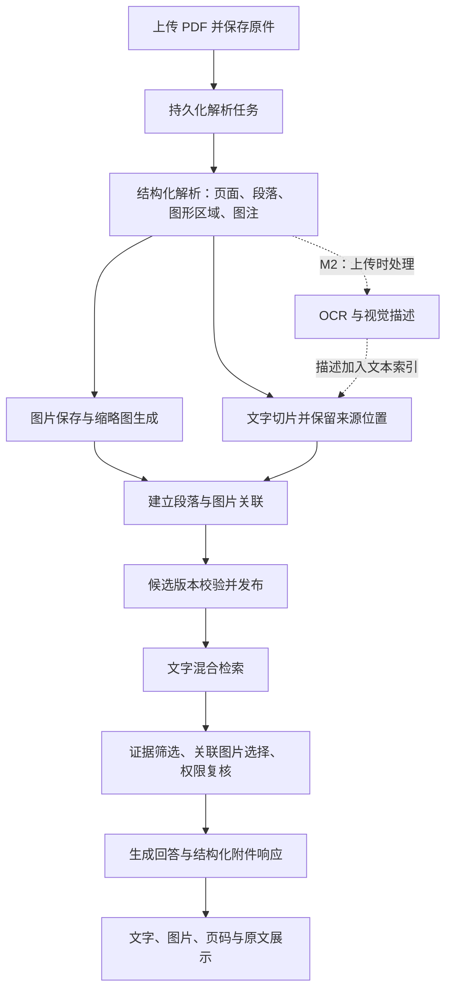

# PDF 图文知识库与回答配图实施计划

> 编写日期：2026-11-10。状态：开发计划，尚未实现。
> 代码基线：后台 `6b61d1a`；前端 `22f85b1`。后续实施前须重新核对最新分支。
> 阅读对象：后端、前端、文档解析与模型服务工程师，以及测试人员。
> 本文是《Spring-AI自研RAG双引擎设计.md》的专项实施补充；本期采用文本检索关联原图，不等于已实现真正的多模态向量检索。

## 1. 目标与交付边界

用户上传含图片的 PDF 后，平台能够保存图片与相关文字的关系。用户提问命中相关知识时，同时看到回答、相关原图、图注、文档名和来源页码，并可查看原文。避免要求运营人员逐条手工制作 FAQ 配图。

典型场景：上传《设备安装手册》，用户问“如何接电源线”，返回操作说明、接线示意图，以及“第 12 页，图 3-2”的来源。没有充分图文关联证据时，允许只返回文字，不能为了配图而显示无关图片。

### 1.1 分期范围

| 阶段 | 交付内容 | 发布要求 |
| --- | --- | --- |
| M1 基础图文闭环 | PDF 图像/图形区域提取，结构化段落关联，图文检索、回答展示、页码溯源、人工纠错、权限、旧文档重建 | 本次功能的首个正式交付；全部验收项通过后才能称为支持 PDF 回答配图 |
| M2 图片语义增强 | 上传时 OCR、视觉模型描述，图片描述参与文本检索，模型通道选择与处理成本统计 | 可独立发布，不阻塞 M1；解决“只有图里才有答案”的检索问题 |
| M3 按需视觉问答 | 复杂问题才向视觉模型发送少量相关原图，回答段落与图片引用对应 | 需要真实图像输入适配与独立评测 |
| M4 跨模态检索 | 多模态 embedding、以文搜图/以图搜图、双空间融合 | 后续专项；不纳入本次工期 |

M1 保留现有文本 embedding。单纯展示已关联的原图，不要求聊天模型具备视觉能力。M1 的文字回答只依据已提取的文字，不得宣传为模型已经读懂图片。

初期仅对自建 `SPRING_AI` 知识库开启。Dify 使用引擎能力声明决定是否展示设置，不得默认具备相同解析与附件能力；其适配另行排期。首期必做 PDF，DOCX/PPTX 使用同一结构化协议预留后续扩展。

## 2. 已核实的代码现状与缺口

| 现有位置 | 代码现状 | 本次处理 |
| --- | --- | --- |
| `rag/parser/DocumentParsingService.java` | `parsePdf` 逐页用 PDFBox 提取文本，整理后拼接；扫描件尝试 OCR | 保留兼容返回，新增结构化解析结果；不能在合并文本时丢掉页码、位置与图片关系 |
| 同文件 `parseImage` | 为独立图片记录地址、描述，存在元数据兜底 | 地址必须对应真实存储对象；不得以占位描述声称完成视觉理解 |
| `model/KnowledgeDocumentChunk.java` | 有 `imageUrl`、`imageCaption`、宽高和 `metadataJson` | 兼容字段保留；新增独立图片实体和多对多关系，单 URL 无法承载段落多图 |
| `rag/pipeline/LocalEmbeddingService.java` | `embedImage` 对地址与描述拼接字符串调用文本 embedding | 明确称为描述文本召回；不能标成真实 `IMAGE_VECTOR` 命中 |
| `rag/SpringAiKnowledgeBaseProvider.java`、`rag/RetrievedChunk.java` | 已有图片字段与部分图片检索传递逻辑 | 扩展为版本一致的结构化图片引用；去重和父子块展开时保留关联 |
| `service/KnowledgeBaseService.java` | `RetrievalContext` 和 `topFaqImages` 主要处理 FAQ 附图 | 扩展到 PDF 图片；不能简单拼接所有召回块的图片 |
| `service/KnowledgeSearchSession.java` | 多轮工具检索会话保存 FAQ 图片 | 支持本次回答的图片证据集合；废弃候选及时移除 |
| `model/ChatResponse.java` | `images` 为兼容性的 URL 列表 | 新增结构化 `attachments` 和 `sources`，保留 `images` |
| `service/AgentChatStreamService.java` | `message_end` 包含 `images` | 同步加入新字段；非流式、流式、历史会话和开放 API 一致 |
| `storage/ObjectStorageService.java` | 已有源文件与产物存储抽象 | 复用本地对象存储；预留 S3/MinIO，禁止解析器临时路径直接出现在回答中 |
| `service/KnowledgeIndexRebuildService.java` | 已有后台重建，但任务状态主要放在内存 | 扩展持久化任务、取消、恢复、版本切换；不能假定现状已满足重建原子性 |
| 前端 `KnowledgeBasePanel.vue` | FAQ 附图管理、召回测试和图片切片展示 | 新增 PDF 解析预览、图片关联编辑、重建入口与处理状态 |
| 前端 `DebugView.vue` | 对话附图依赖 `msg.images`，文案为 FAQ | 升级通用知识附件组件；保留 FAQ 兼容 |

注意：实体存在字段、页面存在按钮，不代表完整链路可用。以上按实际代码核对，开发时仍须追踪每个入口的权限、存储和响应行为。

## 3. 总体流程



解析、OCR 和视觉描述是后台入库任务，不在普通问答请求中重新解析整份 PDF。默认问答只增加关联查询、筛选和受控访问地址生成。

## 4. 文档解析设计

### 4.1 统一结构化输出

在现有 `ParseResult` 兼容层之外，引入 `StructuredDocument` 或等价 DTO：

- 文档级：`documentId`、`sourceRevisionId`、`parserName`、`parserVersion`、`schemaVersion`、`warnings`。
- 页面级：`pageIndex`、`width`、`height`、`rotation`、`blocks`。
- 块级：`blockId`、`type`、`text`、`bbox`、`readingOrder`、`sectionPath`、`figureId`、`caption`。
- 图片级：对象引用、提取方式、像素尺寸、来源区域、图号、图注；不携带外部不可信路径。

内部 `pageIndex` 统一从 0 开始，UI 的 PDF 页序号从 1 开始。印刷页码单列 `printedPageLabel`，允许为空；不得将 PDF 第 12 页和印刷页码 12 混为一谈。

`bbox` 统一为旋转校正后页面的归一化坐标 `[x0,y0,x1,y1]`，左上角为原点，范围 0～1。适配器负责坐标转换，保存原始几何信息用于追查。

### 4.2 解析器选型与试验门槛

建议保留 Java PDFBox 轻量路径，并评估独立 MinerU 解析服务。新增 `DocumentLayoutParser` 适配器，业务层不直接依赖外部解析 JSON。

| 路径 | 用途 | 必须承认的边界 |
| --- | --- | --- |
| PDFBox 文本与嵌入图提取 | 版式简单、文字层清晰的 PDF；提供可控降级 | 提取图片对象不等于获得完整示意图，布局、阅读顺序与矢量图需额外处理 |
| MinerU 结构化服务 | 复杂版式、图注、图片区域、表格与扫描页 | 先评测安装成本、耗时、资源、许可、输出协议和离线能力，再固定版本 |
| 页面渲染与区域裁剪 | 扫描件、由矢量线条构成的接线图，或图片提取不完整 | 需版面区域；缺少可靠区域时只能标记为整页预览，不冒充独立插图 |

用至少 20 份业务 PDF 做选型样本，覆盖文字手册、软件操作截图、多栏排版、扫描件、矢量接线图、旋转页。比较完整图提取、页码定位、图注关联、耗时和内存，形成结果记录后确定默认路径。不能仅凭工具宣传直接替换现有解析器。

MinerU 可以输出结构化内容和图片，但接入时必须固定实际使用版本与输出 schema，不凭文件名推断块关系。参考：https://opendatalab.github.io/MinerU/reference/output_files/ （2026-11-10 查阅）。

### 4.3 提取规则

1. 覆盖图片对象、内联图片、扫描页以及矢量图区域；识别不到区域时保留页面预览兜底。
2. 同一示意图可能由多幅位图、文字与线条组成，优先按版面区域整体裁剪，避免拆成无意义碎片。
3. 为原图生成缩略图，保留比例；原图不因缩略图生成失败而丢失。
4. 重复 Logo、页眉、装饰图结合跨页重复、尺寸和位置降权/标记；不能仅按面积删除小而关键的图。
5. 文件内容哈希用于去重，但不同页面/位置的出现记录必须分别保留。
6. 混合 PDF 按页识别文字层与 OCR 需求，避免用全文件平均字符数漏掉其中的扫描页。
7. 图片失败不必让纯文字入库整体失败；状态显示“文字可用，配图处理部分失败”，并允许重试。
8. 限制文件页数、单页像素、总解码像素、任务时长和输出体积；处理加密、损坏、超大尺寸与异常压缩 PDF。

## 5. 图片与段落如何关联

关联依据按优先顺序处理：明确图号引用 > 图注与图片空间关系 > 同章节同栏邻近段落 > 同页弱关联。

- 先识别“图 3-2”“见下图”等引用，并结合章节消歧，支持图注在下一页或文字跨页。
- 结合版面坐标、阅读顺序和多栏布局；不能仅按字符串距离寻找图片。
- 低置信度的同页关系只用于解析预览，默认不直接随回答出图。
- 保存 `relationType`、置信度、规则/模型版本和人工修订标记，便于解释与纠错。
- 人工可添加、解除、禁用关联；重新处理同一源版本时保留人工修订。更换源文件后进入待复核，不套用旧坐标。
- 长段落切成多个子块时，关联继承需依据块的实际来源区间；父块展开、相邻块补全后统一去重。

M1 不能承诺理解纯图中的业务含义。例如无图注的曲线图，需要 M2 的视觉描述或 M3 的按需看图才能回答趋势问题。

## 6. 数据与存储模型（建议，实施前细化迁移）

当前数据库迁移到 V40。新增迁移在开发分支合并前确认编号，本文不提前占用 V41。

| 建议实体/表 | 关键字段 | 职责 |
| --- | --- | --- |
| `knowledge_media_assets` | id、knowledge_base_id、object_key、thumbnail_key、sha256、mime、width、height、size_bytes、state | 图片文件及存储信息 |
| `knowledge_document_figures` | id、document_id、source_revision_id、parse_version_id、media_asset_id、page_index、printed_page_label、bbox、figure_label、caption、ocr_text、description、section_path、enabled、review_state | 图片在某版文档中的一次出现；整页截图也有明确类型 |
| `knowledge_chunk_figure_links` | chunk_id、figure_id、relation_type、confidence、origin、review_state | 段落与图片多对多关联，唯一约束防重复 |
| `knowledge_document_parse_versions` | id、document_id、source_revision_id、parser_config_hash、state、active、created_at、warnings | 一次不可变解析产物版本及发布状态 |
| `knowledge_media_processing_jobs` | id、document_id、parse_version_id、stage、state、attempt、progress、lease_until、error_code、started_at、finished_at | 可恢复、可重试、可取消的持久化任务 |
| 会话消息附件快照 | message_id、figure_id、来源版本、图注、页码、块引用 | 历史会话保留证据身份，不持久化会过期的临时签名 URL |

所有命名是建议，不是现有表；优先复用已有源文件 revision 与索引版本模型，避免造出重复的版本体系。明确：源文件版本描述上传内容，解析版本描述版面/图片产物，索引版本描述 embedding/检索配置；三者关联但不能混用。

对象键示例：`kb/{kbId}/docs/{documentId}/parse/{parseVersionId}/figures/{figureId}.webp`。图片与其出现记录分离；如按哈希复用文件，应限于相同授权边界，并处理引用计数和延迟回收。禁止跨租户去重暴露资源存在性。

查询按知识库、当前可见文档版本和启用状态约束；为 `document_id + parse_version_id`、`chunk_id`、`media_asset_id`、任务状态/租约建立必要索引。不要把图片二进制或 Base64 放进向量列、召回文本和普通聊天消息。

## 7. 检索、证据选择与回答

### 7.1 M1 检索路径

1. 使用现有向量＋BM25 检索，完成去重和重排。
2. 从最终知识块与父块来源读取关联图片，批量查询，避免 N+1。
3. 剔除未发布、禁用、低置信度、权限不符或来自错误版本的图片。
4. 根据文字相关性、关联类型、图注匹配和图文证据选择图片；显示数量默认最多 3 张，可配置上限。
5. 同一图片内容重复命中时合并，保留最相关的来源位置；不得把同一图在不同业务场景的文字说明误合并。
6. 无可用图片时正常返回文字。不得按“只要同页就全部显示”出图。

BM25、向量相似度、融合分数和关联置信度不共用一个裸阈值。每项记录其分数类型，最终配图策略在标注样本上校准。

### 7.2 证据绑定

生成上下文传入 `sourceId`、`chunkId`、`figureId`、图注和来源，不让模型构造存储 URL。后端只接受当前请求获准证据集合中的引用，并验证模型引用。

M1 允许“回答下方的相关原文配图”，但必须标记其为检索证据配图，不能声称模型已用视觉验证。若回答没有采用该主题的证据，取消候选图；无法确认采用关系时可放入单独“检索参考资料”折叠区。严格段落级图片穿插可在 M3 做。

用户问模型身份、打招呼或知识库未命中时，不因历史轮次命中过知识就继续带图。工具多轮检索按本次最终证据聚合，回退、重试和异常路径清理临时状态，禁止线程间串图。

### 7.3 M2 与 M3

M2 对相关图片生成 OCR 文本与视觉描述，和图注、章节一起用现有文本模型向量化。记录模型标识、提示词版本、处理时间、成本和低置信度；生成描述是衍生资料，不能覆盖原始图注和原图。缓存键至少包含图片哈希、模型版本、提示词版本、配置。

M3 才真正发送图片字节/受控可访问内容给视觉模型；Markdown 中写一个图片 URL 不代表模型实际看到了图片。原生 Ollama、OpenAI 兼容以及自定义 HTTP 分别做协议与能力校验。视觉模型不可用时降级到文字＋来源图，并明确说明无法确认的视觉细节。

M4 的图片与查询文本必须由同一多模态模型映射到同一空间；与现有文本空间分开检索再融合。相同向量维度不意味着可以混合比较。

## 8. 接口契约与兼容

以下为拟新增/扩展契约，URL 需与现有 controller 前缀统一。功能未实现前不得把这些地址当成现成接口。

| 操作 | 建议接口/行为 |
| --- | --- |
| 读取图文解析结果 | `GET /api/knowledge-bases/{kbId}/documents/{docId}/figures`，分页、按页/状态筛选 |
| 启动重处理 | `POST .../documents/{docId}/media-reprocess`，返回 jobId；支持幂等键 |
| 查看/取消任务 | `GET .../media-jobs/{jobId}`；`POST .../media-jobs/{jobId}/cancel` |
| 人工修订 | `PATCH .../figures/{figureId}` 修改图注/启用状态；关联单独增删，带乐观锁版本 |
| 获取原图/缩略图 | 受控 `GET /api/knowledge-media/{mediaId}/content` 或 `/thumbnail` |
| 原文定位 | 受控 PDF 预览入口传 documentId、来源版本、pageIndex 和 bbox；前端使用 PDF 页序号导航 |
| 召回测试 | 返回候选图、最终图、选择原因及排除原因；普通聊天不暴露内部评分细节 |

会话响应增量示例（展示一条附件；`images` 是兼容投影，不能作为新前端的主数据源）：

```json
{
  "images": ["/api/knowledge-media/media-001/content"],
  "attachments": [
    {
      "id": "att-001",
      "type": "KNOWLEDGE_FIGURE",
      "figureId": "fig-001",
      "mediaId": "media-001",
      "sourceId": "src-001",
      "chunkIds": ["chunk-001"],
      "documentId": "doc-001",
      "sourceRevisionId": "rev-001",
      "parseVersionId": "parse-001",
      "documentName": "设备安装手册.pdf",
      "pageIndex": 11,
      "displayPageNumber": 12,
      "printedPageLabel": "10",
      "bbox": [0.1, 0.2, 0.9, 0.7],
      "caption": "图 3-2 电源接线示意图",
      "thumbnailUrl": "/api/knowledge-media/media-001/thumbnail",
      "url": "/api/knowledge-media/media-001/content",
      "usage": "REFERENCE"
    }
  ],
  "sources": [
    {"id": "src-001", "documentId": "doc-001", "pageIndex": 11}
  ]
}
```

- 保持当前 `ChatResponse` 其余字段及 FAQ 的 `images` 行为，新增字段可空，老客户端继续工作。
- 非流式返回同一数据结构；SSE 在现有 `message_end` 扩展 `attachments` 和 `sources`。前端不得等图片处理完成才显示文字 token。
- 检查全部聊天消费者，包括调试、发布后的调用入口、开放 API、历史消息加载及平台助手；不能只改 `DebugView`。
- 首期 `images` 投影规则保持 URL 去重；新前端优先 `attachments`，避免展示两次。FAQ 逐步映射为 `FAQ_IMAGE`，M1 不强制重建旧 FAQ。
- 历史消息读回时按资源身份生成当前可用访问地址并复核权限；删除/撤权后显示“资料已不可用”，不继续暴露旧静态链接。

## 9. UI 设计与交互

### 9.1 知识库文档列表

- 展示“文字可用 / 配图处理中 / 图文就绪 / 部分失败”，同时显示页数、图片数、待确认关联数。
- 文档菜单增加“图文预览”“重新解析配图”；旧文档显示“尚未提取配图”。
- 重处理弹窗说明范围、是否启用 OCR/视觉描述、预计资源占用和当前版本继续可检索；不虚构确定的耗时或费用。
- 任务进度按解析、提图、关联、索引、发布阶段显示，提供失败明细、重试和取消。

### 9.2 图文预览与校正

左侧 PDF 页预览与区域高亮，右侧段落、图片、图注和关联列表；支持按页导航、点击互相定位、图片放大、修改图注、解除/添加关联、排除装饰图。

同页有多张图时分别显示，跨页关系明确标注。低置信度显示“待确认”，不在产品 UI 展示内部模型参数和坐标原始值。允许查看原文与提取图对照；保存失败不丢失编辑内容。

### 9.3 聊天回答

- 文本持续流式输出，下方“参考图片”展示缩略图、图注、文档名、PDF 页序号，点击放大或打开来源页。
- 明确区分“相关原文配图”和“模型已分析的图片”；M1 使用前者。
- 图片 403、删除、网络失败时给出占位与可重试提示，不影响文字阅读；不把损坏图片静默隐藏成空白。
- 支持移动端、键盘访问、图片替代文本、长图注、懒加载及分页/展开更多。
- 刷新历史会话、无记忆模式、切换智能体和中断流式后都验证不串图。

### 9.4 设置

知识库设置增加“文档配图”开关、展示上限、解析模式；M2 再加入 OCR/图片描述模型选择、后台并发与成本限制。通过引擎能力决定可用项，未配置视觉模型时 M1 仍可运行。

## 10. 安全与生命周期

1. 图片、缩略图、PDF 原文和页面裁剪继承同一知识库与文档访问策略，访问时复核 `CurrentActor`；不能只验证 ID 存在。
2. 开放 API 使用现有凭证授权边界；浏览器 `` 无法任意加 Bearer Header 时，采用同源会话代理或有明确有效期/用途的访问票据。普通永久 URL 不作为授权。
3. 返回 URL 不等于授权通过；跨源集成、下载与嵌入方式须在接口文档说明。私有图片禁止公共缓存，签名地址到期后可重新获取。
4. 不沿用未受控的 `/uploads/**` 静态暴露方式保存新 PDF 产物；旧 FAQ 附件治理单列迁移项，不能声称已自动修复。
5. 解析器在受限工作目录运行，验证内容类型、解码尺寸和输出路径；ZIP 解包阻止路径穿越。外部服务设置超时、认证和输出协议校验。
6. OCR/视觉描述中的指令属于不可信资料，不能改变智能体权限或触发工具；前端 Markdown 与 URL 使用现有清洗并补充协议限制。
7. 禁用文档立即停止新检索及图片访问；删除触发关联、缓存和对象回收。历史消息不构成越过撤权的理由。
8. 缓存键包含授权范围、来源/解析/索引版本；撤权、删除和版本切换清除或使旧缓存失效。

## 11. 任务、重建与回滚

- 持久化任务状态：`QUEUED / RUNNING / SUCCEEDED / PARTIAL / FAILED / CANCELLED`；记录阶段、租约、心跳、重试次数和可读错误。
- 幂等依据：documentId、sourceRevisionId、解析器/配置版本；多次点击不能重复生成或重复计费。
- 先构建候选版本与图片关联并校验，再原子切换可检索指针；失败保留旧版本，禁止先删除旧切片再等待外部解析。
- 取消在阶段边界检查；外部调用结果晚到时不得覆盖已取消/更新的版本。重启后根据租约恢复或标记重试。
- 大文件分批写入、限并发、及时释放页面对象；长时间外部调用不能占用数据库事务。
- 图片字节未变时，切换 embedding 模型只重建需要的文字向量；图文解析重建不能无条件重复视觉描述。
- 先选择少量文档试运行，再批量重建历史文档。源文件缺失明确列为不可重建，不能报告成功。
- 功能开关关闭后退回纯文字问答，FAQ 继续工作；旧解析版本和对象按保留策略延迟回收，回滚期间不物理删除仍被引用的数据。

## 12. 性能、资源与费用目标

以下为工程目标，需用固定样本和硬件实测，不是性能承诺：

| 指标 | 初始目标/约束 |
| --- | --- |
| M1 问答新增耗时 | 排除 LLM、网络和图片下载，附件选择与权限查询 p95 ≤ 200ms；同时测开启/关闭后的首字延迟差 |
| 默认显示图片 | 最多 3 张；缩略图长边约 512px，可按清晰度调整 |
| 问答正文体积 | 附件返回元数据与地址，不返回图片 Base64 |
| 本机后台任务 | 从并发 1 起步，优先低峰处理；避免解析/视觉任务与 9B 对话模型争抢显存 |
| OCR/视觉描述成本 | 入库时按图计量、按哈希缓存，失败重试受预算限制 |
| 下载与渲染 | 懒加载缩略图，打开大图才读取原图；报告原图/缩略图体积与访问耗时 |

记录上传至文字可用/图文可用的时间、每页处理耗时、峰值内存、图片数量/大小、解析失败率、问答选图耗时和图片访问错误率。对 8GB 显存的当前开发机不能假设解析器、embedding 和 9B 模型可同时全量驻留。

M1 主要增加开发、磁盘和解析计算成本，不强制新增付费模型。M2 的费用来自 OCR/视觉描述服务或本地算力；以真实样本测量，不沿用历史文档中的模型价格作为当前报价。

## 13. 开发任务拆分与顺序

| 编号 | 任务与主要修改点 | 依赖 | 完成证据 |
| --- | --- | --- | --- |
| T0 | 采集脱敏 PDF，标注段落、图注、正确图片与问题；完成解析器试验 | 无 | 样本清单、基线指标、选型记录 |
| T1 | 冻结 DTO、页码坐标、附件契约、权限策略、版本关系与失败状态 | T0 | JSON 示例与契约测试用例 |
| T2 | 数据迁移、对象存储路径、受控图片/PDF 读取、回收策略 | T1 | 数据升级与越权/删除验证 |
| T3 | 解析适配器、页面区域与提图、缩略图、结构化输出 | T0、T1 | 各类 PDF 产物及定位对照 |
| T4 | 关联规则、人工修改接口、关联继承与去重 | T2、T3 | 标注样本中的关系与误关联分析 |
| T5 | 持久化任务、幂等、重试、取消、候选版本发布、历史重建 | T2～T4 | 中断/重启/失败时旧版本仍可用 |
| T6 | 检索图选择、证据引用、FAQ 兼容、ChatResponse/SSE/API/历史持久化 | T1、T4、T5 | 各入口同源附件、无串图 |
| T7 | 文档状态、图文预览、编辑关联、任务进度 UI | T1；联调依赖 T3～T5 | 页面演示与人工纠错验证 |
| T8 | 通用聊天附件组件、PDF 定位、来源与错误占位，覆盖所有实际消费者 | T1；联调依赖 T6 | 流式/非流式/历史/移动端对照 |
| T9 | 安全、资源、质量评测、灰度、回滚、操作文档 | T2～T8 | 验收报告与可复现命令 |
| T10 | M2 的 OCR/视觉描述路由、模型配置、限流缓存与补处理 | M1 发布后 | 图片语义检索对照评测 |

建议分工：后端负责 T1/T2/T5/T6，解析工程负责 T0/T3/T4，前端负责 T7/T8，测试负责样本与 T9。人员不足时按依赖顺序串行完成。若交由 Gemini、DeepSeek 等开发助手协作，先冻结 T1，再按文件边界分支开发；迁移编号、公共 DTO 和契约由一处维护。

参考排期：第 1～2 个工作日完成 T0/T1；第 3～5 个工作日完成解析、存储和关联；第 6～8 个工作日完成后台任务与前后端联调；第 9～11 个工作日完成评测、权限和异常修复、试运行。估算假设至少后端/解析与前端两个开发角色可并行，复杂扫描件和解析服务部署可能延长工期。M2 需另估，不以压缩验收换取按期发布。

## 14. 验收与测试清单

### 14.1 标注集与质量门槛

建立至少 20 份代表性 PDF、100 个问题的固定验证集，保留独立验收样本，覆盖明确图号、同页多图、跨页图注、纯图、扫描/矢量图、重复 Logo、无图问题和越权问题。

- M1 适用样本中，正确且完整的图像/图形区域提取率目标 ≥ 90%；记录未支持类型，不能从统计中静默移除难例。
- 最终展示图片的相关性精确率目标 ≥ 95%，重点控制错误配图。
- 对标注为“应返回配图”的 M1 可支持问题，正确图片 Recall@3 目标 ≥ 85%；同时报告无出图率，避免靠永不出图获得高精确率。
- 无关问题、打招呼和模型身份问题的错误配图率目标 ≤ 2%；权限泄漏必须为 0。
- 页序号、来源版本和图片位置在验收集逐项正确；清晰度由人工对照确认。
- 纯图含义问题单列 M2/M3 指标，不把 OCR/视觉理解缺失归咎于文本 embedding。

目标须在 T0 确认样本分布后评审，若未达标应列出失败类型并调整能力声明，不能仅修改统计口径。

### 14.2 必测行为

- 一段多图、一图多段、父子块展开、BM25/向量命中、重复图与不同页面出现记录。
- 文本 PDF、混合扫描 PDF、纯扫描、矢量图、旋转页、损坏/加密文件与超限输入。
- 流式中断、工具多轮检索、模型回退、无记忆、新会话、并发用户和历史回显。
- 图为空、图片缺失、缩略图失败、外部解析服务超时、模型不可用、预算耗尽。
- 任务重复提交、进程重启、取消后晚到响应、源文档更新与重建同时进行。
- 发布失败保留旧版本；版本切换后命中块、图片与页码属于同一版本；回滚后仍可读。
- 未登录、跨知识库/租户、撤权后的原图/缩略图/PDF 访问；开放凭证权限与过期票据。
- 新老 FAQ、老客户端 `images`、新客户端 `attachments` 的兼容与不重复显示。
- 新鲜构建 JAR 仅包含当前静态资源，前后端构建通过，运行既有相关测试与新增业务测试。

## 15. 发布与评审清单

- [ ] 确认选型报告、离线部署方式、资源预算、解析输出版本和组件许可。
- [ ] 冻结数据契约及数据库迁移；备份数据库和原件，验证回滚路径。
- [ ] 确认当前附件权限问题与新图片受控入口，未留下绕过鉴权的静态副本。
- [ ] M1 全链路通过：上传 → 解析 → 预览 → 检索 → 配图 → 原文 → 历史。
- [ ] 开放 API 与流式调用通过，新旧 FAQ 兼容。
- [ ] 验收集与资源指标达标，失败类型和已知限制有记录。
- [ ] 默认关闭灰度开关，指定测试知识库和少量文档开启，运行旧文档重建。
- [ ] 更新平台使用说明和开放接口指南，说明 M1 不读取纯图语义的边界。
- [ ] 工程交付附提交号、构建产物、迁移说明、演示样本、测试报告和回滚步骤。

下一次评审优先确认三件事：业务 PDF 的代表样本、解析服务的实测选择，以及 M1 质量门槛。其余按本文默认方案推进，避免把“真正的多模态 embedding”变成基础图文展示的前置条件。
