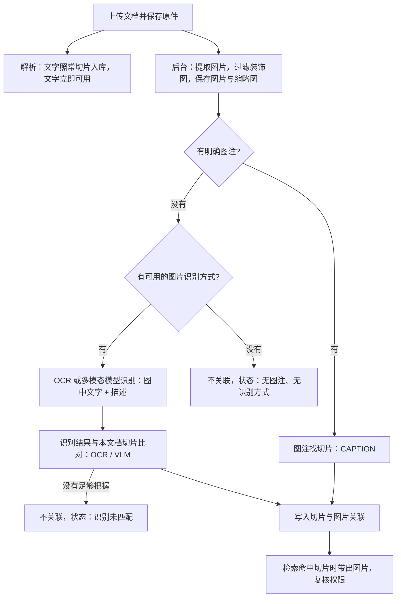

# 文档图文知识库与回答配图实施计划

> 编写日期：2026-11-10；2026-11-11 修订（收窄 M1、Word 优先、外网图片只显示链接、知识库模式与多知识库混合）；2026-11-17 修订（关联方式改为「图注或图片识别文字匹配」，不再按图片位置关联；图片识别可用 OCR 或模型网关里的多模态模型；模型增加「支持图片输入」能力与实测；识别在后台异步进行）。状态：开发计划，尚未实现。
> 代码基线：后台 `6b61d1a`；前端 `22f85b1`。实施前须重新核对最新分支。
> 阅读对象：后端、前端、文档解析工程师，以及测试人员。
> 本文是《Spring-AI自研RAG双引擎设计.md》的专项实施补充。本期用文字检索带出关联原图，不是多模态向量检索，也不代表模型看懂了图片。

## 1. 目标与交付边界

用户上传带图片的文档后，平台为每张图片找出它对应的原文切片。提问命中相关资料时，回答下方同时给出相关原图、图注、文档名和来源位置（PDF 页码 / Word 章节）。运营人员不必再为每条 FAQ 手工配图。

典型场景：上传《设备安装手册》，用户问"如何接电源线"，返回操作说明、接线示意图和"第 12 页，图 3-2"。没有可靠的图文关联时只返回文字，不能为了配图而显示无关图片。

### 1.1 关联原则（2026-11-17 确定）

图片和文字的对应关系**只看文字内容，不看图片在文档里的位置**：

1. **有明确图注**（如"图 3-2 电源接线示意图"）：用图注找到正文中对应的切片，不需要识别图片。
2. **没有图注**：识别图片（OCR，或模型网关里支持图片输入的多模态模型，见 3.3），用识别出的文字和描述与本文档的切片比对，找出对应的切片。
3. **没有图注，也没有可用的图片识别方式**：这张图不关联，回答不带它。

不按位置关联的原因：抽查了三份真实文档，排版各不相同，没有一条位置规则对所有文档都成立：

| 文档 | 图片排布 | 按位置关联的问题 |
| --- | --- | --- |
| 数字标牌 V7.0.0 使用手册（98 张内容图） | 截图放在说明文字之后，几乎没有图注 | 49 张图紧接着就是下一节标题，按"最近一行"会挂到下一节 |
| 广告机 V1.0.0 使用手册（137 张内容图） | 同上 | 72 张图紧接着下一节标题 |
| AIoT-3588A 硬件规格书（26 张内容图） | 接口照片嵌在引脚定义表格里；整板照片上直接标注接口名；有跨页的图 | 最近的文字是表格单元格（"定义""地线"），判断不出所属章节 |

其它文档（图片集中放在开头或末尾、双栏、图文混排）只会更多样，所以不做位置规则。

### 1.2 分期范围

| 阶段 | 交付内容 | 说明 |
| --- | --- | --- |
| M1 基础图文闭环 | 知识库模式（纯文字 / 图文关联）；Word、PDF（文字层 PDF）提取内嵌图片；图片识别（OCR / 多模态模型 / OCR 优先）；模型「支持图片输入」能力与实测；按图注或识别结果关联切片；后台异步识别；检索带出配图、显示来源；文档图片列表与启停；旧文档用「重建索引」补处理 | 本次交付，约 10 个工作日 |
| M1b 其它格式 | Markdown / HTML 以 zip 包（文档 + 图片）上传；PPTX 按幻灯片关联 | M1 之后按需做，复用同一套关联机制 |
| M2 识别结果参与检索 | 把图片识别出的文字和描述作为检索内容，解决"答案只在图里"的问题 | 会改变检索结果，需要单独评测；M1 的识别结果只用于关联 |
| M3 按需看图 | 复杂问题才把少量相关原图发给视觉模型 | 需要视觉模型通道与独立评测 |
| M4 跨模态检索 | 多模态 embedding、以文搜图、以图搜图 | 后续专项 |

M1 保留现有文本 embedding，展示原图不要求聊天模型有视觉能力。M1 的文字回答只依据原文文字，不能宣传为模型已读懂图片。

初期只对自建 `SPRING_AI` 知识库开启；Dify 知识库另行排期。

### 1.3 外网图片链接

Markdown、HTML 里的图片可能写的是外网地址（``、``）。拉取任意外网地址有安全风险（服务端请求伪造、访问内网、下载超大文件），本期**不拉取**：

- 原地址保留在正文里，回答中显示为可点击的「查看图片」链接，不自动加载（与现有聊天 Markdown 渲染一致：图片语法转成链接，避免浏览器自动向外部服务器发请求）。
- 外网图片不进图片库，不参与关联和配图证据；图片的说明文字（alt）和周围文字照常参与检索。
- 拉取、缓存、OCR 外网图片留到后续评估（需要地址白名单、大小限制、内网地址拦截，可复用 `OutboundUrlValidator`）。

### 1.4 知识库模式：纯文字 / 图文关联

每个自建知识库有一个「知识库模式」设置，默认**纯文字**，即现在的行为：

| | 纯文字模式（默认） | 图文关联模式 |
| --- | --- | --- |
| 上传、重建索引 | 和现在完全一样：只取文字，不提取图片 | 文字处理和纯文字模式完全一样，文字先可用；图片提取、识别、关联在后台进行（3.5） |
| 回答 | 只有文字 | 文字 + 相关原图（默认最多 3 张） |
| FAQ 附图 | 照常显示 | 照常显示 |
| 资源 | 不变 | 增加图片存储；图片识别有耗时，用多模态模型时按调用计费 |

图文模式的知识库设置里多一项「图片识别方式」，见 3.3。

图片关联只是在切片之外加一层对应关系，**不改动切片正文**，所以图文模式下的检索结果和纯文字模式一致（如 87 题评测不受影响）。默认纯文字是为了不增加已有知识库（包括板子上的）的入库耗时和存储。

切换规则：

- **纯文字 → 图文关联**：保存时提示"已有文档需要「重建索引」后才有配图"，并提供重建按钮；之后新上传的文档直接按图文处理。
- **图文关联 → 纯文字**：回答立即不再带图，不需要重建；已提取的图片和关联保留，再切回图文时不必重新处理。
- 图文模式下**没有可用的图片识别方式**（模型网关里没有启用的 OCR 配置，也没有选定支持图片输入的模型）时，保存设置提示"只有带图注的图片会配图"；之后配好，对已有文档点「补识别图片」（只处理未关联的图片，不重建文字）。
- FAQ 附图是人工添加的，不受模式影响。
- 外网图片链接在两种模式下都保留在正文中、显示为链接（1.3）。
- Dify 知识库始终是纯文字，不显示此设置。
- 不做智能体级别的配图开关：不能显示图片的调用方（如板子上的语音播报、开放接口）忽略 `attachments` 字段即可；确有需要再加。

### 1.5 智能体关联多个知识库（模式混合）

模式属于知识库，图片跟着切片走，智能体不需要额外设置：

1. 检索照常在智能体关联的所有知识库中进行，合并、去重、按预算裁剪。
2. 只有图文关联模式知识库的切片带有关联图片；纯文字知识库的切片没有。
3. 只从最终交给模型的切片中取图：问题只命中纯文字知识库时回答不带图；命中图文知识库时带出它的配图。

例：智能体关联"产品手册"（图文）和"售后政策"（纯文字）。问"怎么接电源线"命中手册，返回文字 + 接线图；问"退货期限多久"命中售后政策，只有文字；问"安装后发现坏了怎么退"两边都命中，回答综合两边资料，图片只来自手册的切片。

**同一份文档同时在两种模式的知识库里**：两份切片正文相同，现有的按内容去重（`ChunkDedup`）会保留分数高的那条。去重时把被去掉那条的关联图片并到保留的那条上，避免因为纯文字那份分数高而丢掉配图。

其它说明：

- 智能体调试页的已关联知识库旁显示"图文"或"文字"标签，一眼看清配置。
- 3.3 模型自主检索、开放接口规则相同：图片只来自本次回答实际用到的切片。
- 智能体本来就不能同时关联 Dify 和自建知识库，模式混合只发生在自建知识库之间。

## 2. 已核实的代码现状与缺口

| 现有位置 | 现状 | 本次处理 |
| --- | --- | --- |
| `DocumentParsingService.parseDocx` | 只读段落和表格文字，图片丢弃 | 读出内嵌图片（`XWPFRun.getEmbeddedPictures()`），记录所在章节和紧邻的图注候选 |
| `DocumentParsingService.parsePdf` | PDFBox 逐页提取文字；已去页眉页脚、目录并标出章节标题（3.2） | 同一遍解析中取出每页的位图，记录页码和紧邻的图注候选；不改动提取出的正文 |
| `DocumentParsingService.parseHtml` / 纯文本 | HTML 丢弃 ``；Markdown 的图片语法原样当文字 | M1b：zip 包内的本地图片，alt / `<figcaption>` 作为图注；外网地址按 1.3 处理 |
| `rag/parser/RoutingOcrService` | 已有：按模型网关的 OCR 配置路由到本地 PaddleOCR 或云端 OCR；`isAvailable()`、`parseImage()`；目前用于扫描件和图片文档 | 复用，作为图片识别方式之一（3.3） |
| `LlmProvider` | 有 `supportsTools`、`contextWindow`，按通道设置；`models` 是逗号分隔的模型名 | 新增按模型记录的「支持图片输入」能力和最近一次实测结果（3.4） |
| `OpenAiCompatibleClient.toMessages` / 请求体 | 消息 `content` 只有纯文字 | 支持 `content` 数组带 `image_url`（base64 data URL），只用于图片识别调用 |
| `LlmGatewayService.probe` | 测试通道连通性 | 增加「图片输入测试」（3.4） |
| `rag/pipeline/Bm25KeywordIndex`、jieba 分词 | 已有：知识库关键词检索 | 复用分词和打分，把图注 / 识别结果和本文档的切片比对 |
| `SpringAiKnowledgeBaseProvider.uploadDocument` | 解析、向量化、GraphRAG 抽取都在一个事务里同步完成 | 图片识别不放进这个事务，改为提交后在后台处理（3.5） |
| 知识库成本统计（`embeddingTokens`、`estimatedCost`） | 只统计向量化和 Rerank | 增加图片识别的调用次数和 token |
| `KnowledgeDocumentChunk` | 有 `imageUrl`、`imageCaption` 单值字段（图片文档、FAQ 用） | 保留兼容；文档内图片用新表多对多关联 |
| `KnowledgeBaseService.RetrievalContext` / `topFaqImages` | 只处理 FAQ 附图 | 扩展为通用知识配图，FAQ 附图照旧 |
| `rag/pipeline/ChunkDedup` | 按正文（忽略空白、大小写）去重，保留分数高的 | 去重时把被去掉那条的关联图片并到保留的那条（1.5） |
| `KnowledgeBase` | 无模式字段 | 新增知识库模式，默认纯文字（1.4） |
| `KnowledgeSearchSession`（3.3 模型自主检索） | 汇总 FAQ 附图 | 汇总本次回答实际检索到的配图 |
| `ChatResponse.images`、SSE `message_end` | URL 列表 | 新增结构化 `attachments`，保留 `images` 兼容老调用方 |
| `KnowledgeIndexRebuildService`（3.2） | 用原件逐个文档重建切片，后台进行，内存中保存进度 | 重建文字后，把图片放进后台识别队列（3.5）；另加「补识别图片」，只处理未关联的图片 |
| `WebMvcConfig` 的 `/uploads/**` | 静态目录直接对外，不校验权限 | 新图片不放这里，走需要登录和授权的读取接口 |
| 前端 `DebugView.vue` | 对话附图依赖 `msg.images`，文案为 FAQ | 改为通用"参考图片"组件 |

## 3. 核心机制：按文字匹配关联



1. **文字照常处理**：解析、切片、向量化、BM25 和现在完全一样，不在正文里插任何图片标记。文字入库完成后文档即可检索。
2. **提取图片**（后台）：取出文档中的内嵌图片，过滤装饰图（3.2），保存原图和缩略图，记录页码 / 章节。
3. **找图注**：按 3.1 的规则识别明确图注；有图注就在本文档的切片里找包含这句图注或引用了同一图号的切片。
4. **识别图片**：没有图注时，按知识库的「图片识别方式」（3.3）识别；没有可用方式就跳过这张图。
5. **比对**：把识别结果和本文档的切片逐个打分（第 4 节），只有足够有把握时才关联。
6. **回答**：检索命中的切片带出关联图片，随回答单独返回；图片和识别结果都不交给聊天模型。

### 3.1 什么算"明确图注"

| 格式 | 图注来源 | 阶段 |
| --- | --- | --- |
| Word (.docx) | 题注样式（Caption / 题注）的段落；或紧挨图片、以"图 x""Figure x"开头的段落 | M1，最先做 |
| PDF（有文字层） | 紧挨图片上方或下方、以"图 x""Figure x"开头的一行 | M1 |
| Markdown / HTML | 非空的 alt 文字、`<figcaption>` | M1b |
| PPTX | 幻灯片标题 | M1b |
| 扫描件 / 矢量图 | — | 不在 M1；见第 9 节 |

只认上面这些明确写法。"如下图""见下图"、章节标题、表格单元格都**不算**图注，没有明确图注的图片一律走图片识别。

抽查的三份文档里明确图注只有 2 个，所以实际上绝大多数图片会走图片识别：上线这类文档的图文模式前，要先配好 OCR 或多模态模型。

### 3.2 图片提取要点

- 只处理文字层 PDF 和 Word 中内嵌的位图，取原始分辨率（抽查的 PDF 原图像素是页面显示尺寸的 2–3 倍，对识别有利）。由线条绘制的矢量图、叠在照片上的矢量箭头和标注 PDFBox 取不到，M1 不处理；需要时用页面渲染 + 区域裁剪，或评估 MinerU 一类版面解析服务，放到后续。
- 过滤装饰图，不保存、不识别：
  - 跨页重复出现的同一图片（按内容哈希，如 Logo、页眉页脚图标）；
  - 封面页的图片；
  - 被大段正文覆盖的背景图（如章节横幅、整页底图）；
  - 极小的图片。阈值要保守：硬件规格书里 RTC 电池接口的照片显示尺寸很小，但是内容图。宁可多留几张图标让识别和匹配去淘汰（识别不出有效文字就不会关联），也不要误删内容图。
- 一张示意图被拆成多张小位图时，同页相邻的小图合并为一组，识别和关联按组进行；原图分别保存。
- 格式处理：EMF / WMF 转成 PNG；CMYK JPEG 转 RGB；带透明蒙版的图片铺白底；GIF 取第一帧。转换失败的图片标记失败，不影响其它图片。
- 图片处理或识别失败不影响文字入库，文档状态显示"文字可用，部分配图处理失败"。

### 3.3 图片识别方式

图文模式的知识库设置「图片识别方式」：

| 方式 | 做法 | 适合 | 代价 |
| --- | --- | --- | --- |
| OCR | `RoutingOcrService`（本地 PaddleOCR 或云端 OCR）识别图中文字 | 软件截图、带标注的照片 | 快、便宜；读不出没有文字的照片和示意图 |
| 多模态模型 | 模型网关里选定一个「支持图片输入」的模型（3.4），一次调用返回图中文字和画面描述 | 截图、照片、示意图都能处理 | 每张图一次模型调用，云端每张约几秒，按量计费 |
| OCR 优先（推荐） | 先 OCR；清洗后文字太少、或匹配没有足够把握时，再交给多模态模型 | 混合文档 | 大部分截图只花 OCR 的成本 |

- 只配了其中一种时，只能选那一种；两种都没有时按 1.1 第 3 条处理。
- 多模态模型调用：
  - 固定提示词，要求只返回 JSON：`{"text": "图中能看清的文字，按原样", "description": "画面内容，100 字以内"}`；不提供文档名、章节、周围文字等位置线索，避免模型照抄线索、关联退化成按位置。
  - 温度 0，限制输出长度；关闭思考（不支持关闭参数的服务按通道的处理方式，如消息末尾加 `/no_think`）。
  - 发送前把长边缩到上限（如 1568 像素，按样本调整）并压缩，控制 token 和请求体大小。
  - 返回不是合法 JSON 时，整段内容当作 `description`；为空则判为识别失败。
  - 提示词带版本号，修改提示词后可以对已有图片「重新识别」。
- 识别结果（OCR 文字、模型返回的文字和描述）只用于关联和管理员查看，**不参与检索**（参与检索是 M2）。

### 3.4 模型的「支持图片输入」能力

OpenAI 兼容接口没有标准方式查询模型能否接收图片（`/v1/models` 只返回模型 ID），所以按三层确定：

1. **预置默认值**：厂商目录（`LlmVendorCatalog`）里已知支持图片输入的模型默认开启（如 DeepSeek V4.1 Flash、通义千问 VL、智谱 GLM-4V、豆包视觉模型，实施时按各家文档核对）。Ollama 通道读取 `/api/show` 返回的 `capabilities` 是否含 `vision`。自定义通道默认关闭。
2. **图片输入测试**：通道测试里增加一项。平台临时生成一张写有随机 4 位数字的图片（只用数字，避免服务器缺中文字体），问模型"图中的数字是多少"：
   - 接口报错（如 400）：不支持；
   - 正常返回但数字不对：图片被忽略（有的服务只支持文字，会丢掉图片照样返回 200），判为不支持；
   - 数字正确：支持。
3. **管理员确认**：开关由管理员最终决定，旁边显示最近一次测试结果和时间。

能力按**模型**记录，不按通道：一个通道可能挂多个模型，有的支持图片、有的不支持。知识库选择图片识别模型时，只列出已开启该能力的模型。（现有的「支持工具调用」仍按通道，本期不改。）

### 3.5 后台处理

- 上传和重建时，文字处理照旧；图片提取和识别在文字所在事务**提交之后**放进后台队列，不占用数据库事务，不拖慢上传接口。
- 每张图片的处理状态记在 `knowledge_figures.link_status`（初始 `PENDING`）。程序重启后，后台把 `PENDING` 的图片接着处理，不需要持久化任务表。
- 并发数可配置（OCR 和多模态模型分开设置）；遇到限流（429）、超时按退避重试，超过次数标记失败，可以手动「重新识别」。
- **结果缓存**：按 图片 sha256 + 识别方式 + 模型 + 提示词版本 缓存识别结果。同一张图在多份文档、多次重建里只识别一次，重建知识库不会重复计费。
- **费用控制**：
  - 知识库成本统计增加图片识别的调用次数和 token；
  - 对整个知识库「重建索引」或「补识别图片」前，提示待识别的图片数（扣除缓存命中）和使用的识别方式，确认后再执行；
  - 单个文档、单个知识库可设图片识别上限，超出的图片标记为跳过。
- 文档列表显示图片处理进度（如"配图处理中 40 / 98"）。

## 4. 关联规则

关联类型：

| 类型 | 条件 | 可信度 |
| --- | --- | --- |
| `CAPTION` | 图注文字出现在某个切片中，或切片引用了图注里的图号（如"见图 3-2"） | 高 |
| `OCR` | OCR 文字与某个切片的匹配分达到阈值，且明显高于本文档其它切片 | 中，需要阈值校准 |
| `VLM` | 多模态模型返回的文字和描述与某个切片的匹配分达到阈值，且明显高于其它切片 | 中，需要单独校准阈值 |
| `MANUAL` | 管理员手动指定 | 高 |

规则：

1. **只在同一份文档内比对**，不跨文档关联。比对对象是子切片正文加上下文标题（3.2 的「文档 › 章 › 节」）。
2. **CAPTION**：图注所在的切片和引用了同一图号的切片都关联；一张图可以关联多个切片。
3. **OCR / VLM**：
   - 识别出的文字先清洗：去掉过短的碎片（如单个字母、纯数字、引脚号），去掉在本文档大多数切片里都出现的常见词；清洗后字数太少（阈值在样本上确定）的不参与比对。
   - 多模态模型的 `text` 和 `description` 一起参与比对；`text` 权重更高（原样文字比描述可靠）。
   - 用 jieba 分词后按 BM25 给本文档的每个切片打分，取最高分的切片；最高分要达到绝对阈值，并且比第二名高出一定比例，否则判为"没有足够把握"，不关联。
   - 第一名和第二名是父子关系或相邻切片时视为同一处，不算冲突。
   - 典型的不关联情况：整板照片上的接口名（HDMI IN、DCIN）在多个切片里都出现，分不出高下。
   - OCR 和 VLM 的阈值分别用验收样本校准（第 13 节），校准前不上线。
4. **其它情况一律不关联**：没有图注又没有识别方式、识别没有得到有效文字、匹配没有足够把握。宁可少配图，不配错图。
5. 管理员可以在文档图片列表中停用某张图、修改图注，或给"未关联"的图手动指定切片；M1 不做批量编辑。
6. 图片识别出的文字可能包含指令式内容（如截图里写着"忽略之前的要求"）。识别结果只用于打分和管理员查看，不进入聊天模型的上下文，所以不会影响回答。

## 5. 数据与存储

当前数据库迁移到 V40，本期新增一个迁移（编号在合并前确认）：

| 表 | 关键字段 | 职责 |
| --- | --- | --- |
| `knowledge_figures` | id、knowledge_base_id、document_id、figure_no（文档内序号）、object_key、thumbnail_key、sha256、mime_type、width、height、size_bytes、page_index（PDF，0 起）、section_title、caption、recognized_text、description、recognizer（`OCR` / `VLM`）、recognizer_model、prompt_version、link_status（`PENDING` / `LINKED` / `NO_CAPTION_NO_RECOGNIZER` / `NO_TEXT` / `NO_MATCH` / `SKIPPED_LIMIT` / `FAILED`）、enabled、created_at、updated_at | 文档中的一张图片 |
| `knowledge_chunk_figures` | chunk_id、figure_id、relation_type（`CAPTION` / `OCR` / `VLM` / `MANUAL`）、match_score、唯一约束(chunk_id, figure_id) | 切片与图片多对多 |
| `knowledge_figure_recognitions` | sha256、recognizer、recognizer_model、prompt_version、recognized_text、description、tokens、created_at，唯一约束(sha256, recognizer, recognizer_model, prompt_version) | 识别结果缓存（3.5） |
| `knowledge_bases` 新增列 | content_mode：`TEXT`（默认，空值同此）/ `TEXT_IMAGE`；image_recognition：`OCR` / `VLM` / `OCR_THEN_VLM`；image_recognition_model；image_limit | 知识库模式与图片识别设置 |
| 模型能力 | 按通道 + 模型名记录 supports_image_input、最近一次图片输入测试结果和时间（新表或 `llm_providers` 的 JSON 列，实施时定） | 3.4 |

- 对象存储复用 `ObjectStorageService`，路径如 `kb/{kbId}/docs/{documentId}/figures/{figureId}.{ext}`，缩略图同目录 `*_thumb.webp`（或 jpg）。
- 页码：内部 `page_index` 从 0 开始，界面显示 +1；印刷页码本期不处理。
- `recognized_text`、`description` 只用于关联和管理员查看，不参与检索、不交给聊天模型。
- 删除文档时删除其图片记录、关联和文件；重建文档时先生成新图片和关联，再替换旧的，事务提交后回收旧文件。
- 图片二进制不写进数据库、向量或聊天记录。
- 复杂的解析版本、持久化任务、历史消息附件快照放到后续（见第 9 节）。

## 6. 检索与回答

1. 现有向量 + BM25 检索、重排、去重不变；去重时合并关联图片（1.5）。
2. 从最终交给模型的切片（含父块展开）批量查询关联图片，剔除停用、所属文档已禁用、所属知识库当前为纯文字模式或无权访问的图片。
3. 按切片排名和关联类型（`CAPTION`、`MANUAL` 优先于 `OCR`、`VLM`）选图，同一图片只出现一次，默认最多 3 张（可配置）。
4. 没有可用图片时正常只返回文字；不因历史轮次命中过资料而继续带图。
5. 3.3 模型自主检索：按本次回答所有 `search_knowledge` 调用的最终结果汇总，回答结束后清理。
6. 回答下方标注为"参考图片（来自检索到的原文）"，不声称模型看过图片。M1 不做回答段落与图片逐句对应。

## 7. 接口契约

| 操作 | 接口 |
| --- | --- |
| 文档的图片列表（含处理和关联状态、识别结果） | `GET /api/knowledge-bases/{kbId}/documents/{docId}/figures` |
| 启停图片、修改图注、手动指定关联切片 | `PATCH /api/knowledge-bases/{kbId}/figures/{figureId}` |
| 读取原图 / 缩略图 | `GET /api/knowledge-figures/{figureId}/content`、`/thumbnail`，校验登录用户或开放凭证对所属知识库的使用权限 |
| 重新识别 / 补识别图片 | `POST /api/knowledge-bases/{kbId}/figures/recognize`（范围：单张、文档、未关联、全部；返回待识别数和预计调用量，确认后执行） |
| 模型图片输入测试 | `POST /api/model-gateway/providers/{id}/probe-image`（参数：模型名） |
| 召回测试 | 结果中附带每个切片的关联图片和关联类型 |

回答新增字段示例（`images` 保留为兼容投影）：

```json
{
  "images": ["/api/knowledge-figures/fig-001/content"],
  "attachments": [
    {
      "type": "KNOWLEDGE_FIGURE",
      "figureId": "fig-001",
      "documentId": "doc-001",
      "documentName": "设备安装手册.pdf",
      "pageNumber": 12,
      "sectionTitle": "电源连接",
      "caption": "图 3-2 电源接线示意图",
      "relationType": "CAPTION",
      "thumbnailUrl": "/api/knowledge-figures/fig-001/thumbnail",
      "url": "/api/knowledge-figures/fig-001/content"
    }
  ]
}
```

- 没有图注的图片，`caption` 为空，界面显示"章节标题 · 第 N 页"。
- 非流式响应和 SSE `message_end` 返回同样的字段；文字照常流式输出，不等图片。
- 调试页、开放接口、历史会话、平台助手等所有聊天入口都要核对，不能只改调试页。
- FAQ 附图继续放在 `images`，同时映射为 `type: FAQ_IMAGE` 的附件；新前端优先用 `attachments`，避免同一张图显示两次。
- 开放接口调用方无法带登录态加载图片时，返回带有效期的访问地址（签名参数），不提供永久公开地址。
- 历史会话只保存图片 ID，读取时重新校验权限；图片被删除或无权访问时显示"资料已不可用"。

## 8. 界面

- **文档列表**：显示每个文档的图片数、处理进度和已关联数（如"配图处理中 40 / 98""已关联 82 / 98"）；处理失败时显示"部分配图处理失败"。
- **文档图片列表**：按页（PDF）或章节（Word）列出缩略图、图注、处理和关联状态（处理中 / 已关联 / 无图注且无识别方式 / 未识别到文字 / 未匹配 / 超出上限 / 失败）、识别方式和模型、关联到的切片、识别出的文字和描述；可启停、修改图注、给未关联的图手动指定切片、重新识别、查看大图。M1 不做 PDF 页面预览与区域高亮编辑。
- **召回测试**：命中切片下方显示关联图片和关联类型。
- **聊天回答**：回答下方"参考图片"显示缩略图、图注（没有时显示章节和页码）、文档名，点击放大；加载失败显示占位，不影响文字。外网图片链接按 1.3 显示为链接。
- **知识库设置**：新增「知识库模式」（纯文字 / 图文关联，默认纯文字）、「图片识别方式」（OCR / 多模态模型 / OCR 优先）、识别用的模型（只列出支持图片输入的）、图片识别上限和配图显示上限；切换时按 1.4 提示是否需要重建；没有可用识别方式时提示只有带图注的图片会配图；使用云端 OCR 或云端模型时提示图片会发给第三方。知识库列表和详情页显示当前模式。
- **模型网关**：模型列表里每个模型显示「支持图片输入」开关和最近一次图片输入测试结果；通道测试增加「图片输入测试」。
- **智能体调试页**：已关联知识库旁显示"图文"或"文字"标签。

## 9. 后续（不在 M1）

以下是原计划中的内容，价值明确但对当前使用规模偏重，等 M1 上线、有真实使用数据后再排期：

- M2 识别结果参与检索：图片识别出的文字和描述进入检索内容，解决"答案只在图里"的问题（如整板照片上的接口位置）；需要单独评测对现有检索的影响。
- 版面解析服务（如 MinerU）：处理多栏、矢量图、扫描件；先用业务 PDF 实测效果、耗时、资源、许可和离线部署，再决定是否接入。
- 解析版本与候选版本原子切换、可恢复的持久化任务（取消、重试、进程重启后恢复）。
- PDF 页面预览、区域高亮、批量编辑图文关联。
- 历史消息附件快照（保存来源版本、页码）。
- M3 按需看图、M4 跨模态检索。
- 外网图片的受控拉取（第 1.3 节）。

## 10. 安全

1. 图片读取接口按所属知识库校验权限：登录用户要有使用权，开放凭证要能访问对应智能体关联的知识库；只校验 ID 存在不够。
2. 新图片不放进 `/uploads/**` 静态目录。旧 FAQ 附图的静态暴露问题单独治理，本期不声称已修复。
3. 解析时限制单个文档的图片数、单张图片像素和总大小；超限的图片跳过并记录，不让整个文档入库失败。
4. 使用云端 OCR 或云端多模态模型时，文档图片会发给第三方服务：知识库设置里提示这一点；敏感文档应使用本地 PaddleOCR 或本地模型。
5. 图片识别结果只用于关联打分和管理员查看，不进入聊天模型上下文（第 4 节第 6 条）；界面展示识别结果时按纯文本转义。
6. zip 包（M1b）解压时阻止路径穿越、限制文件数和解压后总大小；只接受常见图片格式。
7. 图片按内容类型校验后再保存；返回时设置正确的 `Content-Type`，禁止浏览器猜测类型（`nosniff`），私有图片不允许公共缓存。
8. 外网图片地址不由服务端访问（第 1.3 节）。

## 11. 重建与回滚

- 已有文档通过知识库详情页的「重建索引」补处理图片：用保存的原件重新提取图片、识别图注，放进后台识别队列。
- 后来才配置识别方式、或换了识别模型 / 提示词的知识库，用「补识别图片」或「重新识别」处理，不需要重建文字；识别结果有缓存，同一张图不重复计费。
- 原件缺失的文档跳过并在重建结果中列出。
- 知识库切回纯文字模式后，回答立即不再带图，FAQ 附图照常（1.4）。
- 回滚到旧版本程序时，新表不影响旧版本运行。

## 12. 开发任务与顺序

| 编号 | 任务 | 依赖 | 完成标志 |
| --- | --- | --- | --- |
| T1 | 数据迁移（图片表、关联表、识别缓存表、知识库设置列、模型能力）、实体、图片存储与缩略图、受控读取接口（含权限） | 无 | 越权访问被拒绝；删除文档时图片一并删除 |
| T2 | 关联服务：图注匹配（含图号引用）、识别结果清洗与 BM25 比对、阈值与"足够把握"判断、`ChunkDedup` 合并图片 | 无 | 单元测试覆盖图注命中、图号引用、唯一命中、歧义不关联、文字过少不关联 |
| T3 | 模型「支持图片输入」能力：预置默认值、Ollama 能力读取、图片输入测试、按模型记录；`OpenAiCompatibleClient` 支持图片消息 | 无 | 用一个支持和一个不支持图片的模型测试，结果正确；丢弃图片照样返回 200 的服务判为不支持 |
| T4 | 后台识别队列：事务提交后入队、`PENDING` 重启续跑、并发与退避重试、结果缓存、费用统计与上限、补识别 / 重新识别；接入 OCR 和多模态模型两种识别方式及"OCR 优先" | T1、T2、T3 | 上传接口耗时与纯文字模式相同；重启后继续处理；同一张图只识别一次 |
| T5 | Word 图片提取、图注识别、格式转换；上传与重建按知识库模式接入 | T1、T4 | 纯文字模式解析结果与现在完全一致；图文模式用 3 份以上带图 Word 文档端到端走通；没有识别方式时只关联带图注的图 |
| T6 | PDF 图片提取、装饰图过滤、小图合组、图注识别 | T5 | 三份验收 PDF 的装饰图过滤结果人工核对通过，没有误删内容图 |
| T7 | 检索后选图（按模式过滤）、`attachments`、SSE、FAQ 兼容、模型自主检索汇总 | T1、T2 | 流式、非流式、历史会话、开放接口返回一致 |
| T8 | 前端：知识库模式与图片识别设置、费用确认、参考图片组件、文档图片列表（状态、识别结果、手动指定、重新识别）、模型网关图片能力与测试、召回测试显示、调试页模式标签 | T3、T4、T7 | 调试页、知识库页面和模型网关演示 |
| T9 | 用验收样本校准 OCR 和 VLM 的匹配阈值，对比三种识别方式的关联率、正确率、耗时和费用 | T4、T6 | 第 13 节指标达标，阈值写入配置 |
| T10 | 验收样本测试、问题修复、使用说明更新 | T5–T9 | 第 13 节指标和测试清单通过 |

参考排期：T1–T3 约 3 天，T4 约 2 天，T5–T6 约 2 天，T7–T8 约 2 天，T9–T10 约 1 天，合计约 10 个工作日（单人）。M1b、M2 另行评估。

## 13. 验收

### 13.1 样本与指标

样本：

- 数字标牌 V7.0.0 使用手册、广告机 V1.0.0 使用手册（软件截图，基本没有图注，走图片识别）；
- AIoT-3588A+V5.0 硬件规格书（图片嵌在表格里、整板照片带标注、实物照片没有文字）；
- 3–5 份带截图的 Word 文档，其中至少 1 份有规范题注（走图注）。

每份 5–10 个问题，覆盖应配图、不应配图、打招呼、无权限访问。

- 展示图片的相关性（人工判断）≥ 95%：宁可不出图，不出错图。
- 应配图的问题，正确图片出现在前 3 张中的比例 ≥ 80%；同时报告不出图的比例。
- 按文档、按识别方式（OCR / 多模态模型 / OCR 优先）报告关联率（已关联 / 内容图片总数）、关联的人工抽查正确率、入库耗时和识别费用；OCR 和 VLM 关联正确率都 ≥ 95%。
- 打招呼、无关问题的错误配图率 ≤ 2%；权限泄漏为 0。
- 页码、章节与原文一致。
- 未达标时列出失败类型，调整阈值或能力说明，不改统计口径。

### 13.2 必测行为

- 一张图关联多个切片、一个切片多张图、父块展开、BM25 与向量分别命中。
- 图注命中、图号引用命中；识别结果唯一命中；识别文字在多个切片里都出现（应不关联）；没识别出文字。
- 没有任何识别方式：只有带图注的图片配图，其它图片状态为"无图注、无识别方式"；配好后「补识别图片」补上关联，文字不重建。
- 本地 PaddleOCR、云端 OCR、多模态模型、OCR 优先各跑一遍；识别服务不可用、限流、超时时文字入库不受影响，图片标记失败或稍后重试。
- 多模态模型返回非 JSON、空内容；不支持关闭思考的模型；超大图片缩放后发送。
- 程序在图片处理中途重启，重启后继续；同一张图出现在两份文档里只识别一次；换识别模型后可重新识别。
- 图片输入测试：支持图片的模型通过；只支持文字、丢弃图片照样返回 200 的服务判为不支持。
- 文字层 PDF、带装饰 Logo 的 PDF、封面和背景图、损坏或加密文件、超大图片。
- 流式中断、模型自主检索多次调用、备用通道切换、无记忆模式、新会话、历史回显。
- 图片被停用、文档被删除、权限被撤销后的回答与图片访问。
- 老调用方只读 `images`、新前端读 `attachments`，不重复显示。
- 知识库模式：纯文字和图文模式下切片内容、检索结果完全一致；纯文字 → 图文需重建才有配图，新上传直接有图；图文 → 纯文字后回答立即不带图，再切回无需重建。
- 模式混合：智能体同时关联图文和纯文字知识库，只命中纯文字时不出图，两边都命中时图片只来自图文知识库；同一文档同时在两种模式的知识库里时只出现一次，且保留配图。
- 现有检索评测（87 题）在两种模式下结果都不变。
- 打包后的 jar 只包含当前前端资源；前后端构建和现有测试通过。

## 14. 发布清单

- [ ] 数据库迁移可重复执行；部署前备份数据库。
- [ ] 图片读取接口权限测试通过，未新增静态公开目录。
- [ ] 全链路通过：上传 → 解析 → 图片提取 → 图注 / 图片识别 → 关联 → 图片列表 → 检索 → 配图 → 历史会话。
- [ ] 开放接口和流式调用返回附件，老字段兼容。
- [ ] OCR 和 VLM 匹配阈值已用验收样本校准并写入配置。
- [ ] 验收样本达标，已知限制写入使用说明（只读文字、不理解图片内容；没有图注又没有识别方式的图片不配图；只用 OCR 时没有文字的照片和示意图不配图；矢量图和扫描件暂不支持）。
- [ ] 部署后所有已有知识库仍为纯文字模式，行为不变；板子上先选一个知识库切到图文模式并重建试运行，记录图片识别耗时和费用，再决定其余知识库。板子上的 Qwen3-8B 不支持图片输入，板子上的知识库用本地 PaddleOCR，或在服务器上用多模态模型处理。
