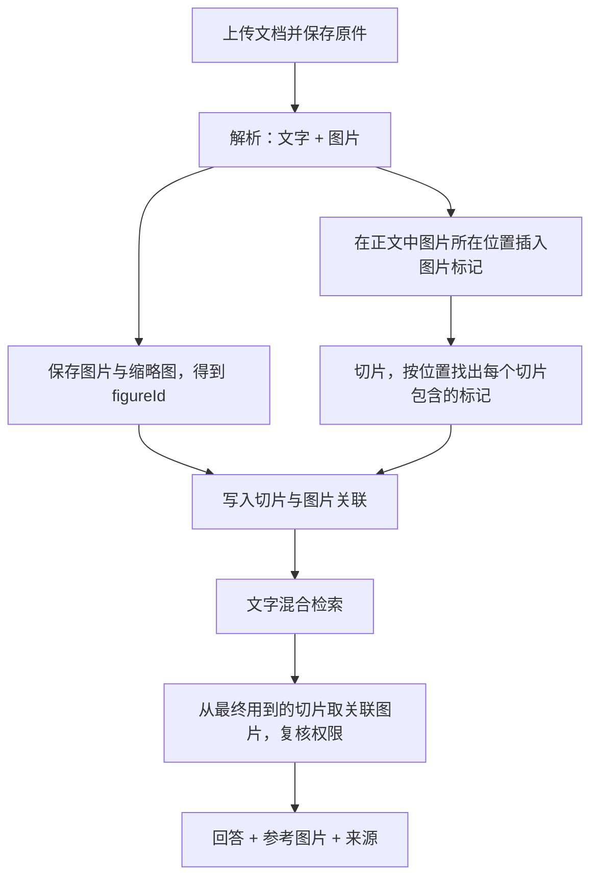

# 文档图文知识库与回答配图实施计划

> 编写日期：2026-11-10；2026-11-11 修订（收窄 M1、各格式统一用图片标记、Word 优先、外网图片只显示链接、知识库模式与多知识库混合）。状态：开发计划，尚未实现。
> 代码基线：后台 `6b61d1a`；前端 `22f85b1`。实施前须重新核对最新分支。
> 阅读对象：后端、前端、文档解析工程师，以及测试人员。
> 本文是《Spring-AI自研RAG双引擎设计.md》的专项实施补充。本期用文字检索带出关联原图，不是多模态向量检索，也不代表模型看懂了图片。

## 1. 目标与交付边界

用户上传带图片的文档后，平台保存图片和它所在位置的文字关系。提问命中相关资料时，回答下方同时给出相关原图、图注、文档名和来源位置（PDF 页码 / Word 章节）。运营人员不必再为每条 FAQ 手工配图。

典型场景：上传《设备安装手册》，用户问"如何接电源线"，返回操作说明、接线示意图和"第 12 页，图 3-2"。没有可靠的图文关联时只返回文字，不能为了配图而显示无关图片。

### 1.1 分期范围

| 阶段 | 交付内容 | 说明 |
| --- | --- | --- |
| M1 基础图文闭环 | 知识库模式（纯文字 / 图文关联）；Word、PDF（文字层 PDF）提取内嵌图片；图片和段落关联；检索带出配图、显示来源；文档图片列表与启停；旧文档用「重建索引」补处理 | 本次交付，约 6 个工作日 |
| M1b 其它格式 | Markdown / HTML 以 zip 包（文档 + 图片）上传；PPTX 按幻灯片关联 | M1 之后按需做，复用同一套机制 |
| M2 图片语义增强 | 入库时对图片做 OCR、视觉模型描述，描述参与文字检索 | 解决"答案只在图里"的问题，不阻塞 M1 |
| M3 按需看图 | 复杂问题才把少量相关原图发给视觉模型 | 需要视觉模型通道与独立评测 |
| M4 跨模态检索 | 多模态 embedding、以文搜图、以图搜图 | 后续专项 |

M1 保留现有文本 embedding，展示原图不要求聊天模型有视觉能力。M1 的文字回答只依据提取出的文字，不能宣传为模型已读懂图片。

初期只对自建 `SPRING_AI` 知识库开启；Dify 知识库另行排期。

### 1.2 外网图片链接

Markdown、HTML 里的图片可能写的是外网地址（``、``）。拉取任意外网地址有安全风险（服务端请求伪造、访问内网、下载超大文件），本期**不拉取**：

- 原地址保留在正文里，回答中显示为可点击的「查看图片」链接，不自动加载（与现有聊天 Markdown 渲染一致：图片语法转成链接，避免浏览器自动向外部服务器发请求）。
- 外网图片不进图片库，不参与关联和配图证据；图片的说明文字（alt）和周围文字照常参与检索。
- 拉取、缓存、OCR 外网图片留到后续评估（需要地址白名单、大小限制、内网地址拦截，可复用 `OutboundUrlValidator`）。

### 1.3 知识库模式：纯文字 / 图文关联

每个自建知识库有一个「知识库模式」设置，默认**纯文字**，即现在的行为：

| | 纯文字模式（默认） | 图文关联模式 |
| --- | --- | --- |
| 上传、重建索引 | 和现在完全一样：只取文字，不插图片标记，不提取图片 | 提取 Word、PDF 中的图片，插入图片标记，建立切片与图片关联 |
| 回答 | 只有文字 | 文字 + 相关原图（默认最多 3 张） |
| FAQ 附图 | 照常显示 | 照常显示 |
| 资源 | 不变 | 增加图片存储；解析稍慢 |

默认纯文字的原因：图片标记会改变参与检索的正文，可能影响现有检索结果（如 87 题评测）；默认关闭时已有知识库（包括板子上的）完全不受影响，只在需要配图的知识库（如带截图的产品手册）上开启。

切换规则：

- **纯文字 → 图文关联**：保存时提示"已有文档需要「重建索引」后才有配图"，并提供重建按钮；之后新上传的文档直接按图文处理。
- **图文关联 → 纯文字**：回答立即不再带图，不需要重建；已提取的图片和关联保留，再切回图文时不必重新处理。提示中说明：如需检索结果与切换前的纯文字完全一致，可再重建一次以去掉正文中的图片标记。
- FAQ 附图是人工添加的，不受模式影响。
- 外网图片链接在两种模式下都保留在正文中、显示为链接（1.2）。
- Dify 知识库始终是纯文字，不显示此设置。
- 不做智能体级别的配图开关：不能显示图片的调用方（如板子上的语音播报、开放接口）忽略 `attachments` 字段即可；确有需要再加。

### 1.4 智能体关联多个知识库（模式混合）

模式属于知识库，图片跟着切片走，智能体不需要额外设置：

1. 检索照常在智能体关联的所有知识库中进行，合并、去重、按预算裁剪。
2. 只有图文关联模式知识库的切片带有关联图片；纯文字知识库的切片没有。
3. 只从最终交给模型的切片中取图：问题只命中纯文字知识库时回答不带图；命中图文知识库时带出它的配图。

例：智能体关联"产品手册"（图文）和"售后政策"（纯文字）。问"怎么接电源线"命中手册，返回文字 + 接线图；问"退货期限多久"命中售后政策，只有文字；问"安装后发现坏了怎么退"两边都命中，回答综合两边资料，图片只来自手册的切片。

**同一份文档同时在两种模式的知识库里**：图文那份的切片正文带图片标记，按现有的按内容去重（`ChunkDedup`）会被当成两条不同资料，同时出现。规则：

- 比较内容前先去掉图片标记，两份仍算重复；
- 保留分数高的那条，同时把另一条的关联图片并到保留的那条上，避免因为纯文字那份分数高而丢掉配图。

其它说明：

- 图片标记本身只增加很少的文字；图注（如"电源接线示意图"）是真实内容，可能让图文知识库的切片更容易被问到配图相关问题时命中，这是预期效果，不做额外修正。
- 智能体调试页的已关联知识库旁显示"图文"或"文字"标签，一眼看清配置。
- 3.3 模型自主检索、开放接口规则相同：图片只来自本次回答实际用到的切片。
- 智能体本来就不能同时关联 Dify 和自建知识库，模式混合只发生在自建知识库之间。

## 2. 已核实的代码现状与缺口

| 现有位置 | 现状 | 本次处理 |
| --- | --- | --- |
| `DocumentParsingService.parseDocx` | 只读段落和表格文字，图片丢弃 | 读出段落里的内嵌图片（`XWPFRun.getEmbeddedPictures()`），按出现位置在正文里插入图片标记 |
| `DocumentParsingService.parsePdf` | PDFBox 逐页提取文字；已去页眉页脚、目录并标出章节标题（3.2） | 同一遍解析中记录每页图片的绘制位置，按纵向位置把图片标记插入该页文字 |
| `DocumentParsingService.parseHtml` / 纯文本 | HTML 丢弃 ``；Markdown 的图片语法原样当文字 | M1b：zip 包内的本地图片做标记；外网地址按 1.2 处理 |
| `DocumentChunker.contextTitles` | 3.2 已能按切片在原文中的位置算出章节标题 | 同样按位置找出每个切片包含的图片标记 |
| `KnowledgeDocumentChunk` | 有 `imageUrl`、`imageCaption` 单值字段（图片文档、FAQ 用） | 保留兼容；文档内图片用新表多对多关联 |
| `KnowledgeBaseService.RetrievalContext` / `topFaqImages` | 只处理 FAQ 附图 | 扩展为通用知识配图，FAQ 附图照旧 |
| `rag/pipeline/ChunkDedup` | 按正文（忽略空白、大小写）去重，保留分数高的 | 比较前去掉图片标记；去重时把被去掉那条的关联图片并到保留的那条（1.4） |
| `KnowledgeBase` | 无模式字段 | 新增知识库模式，默认纯文字（1.3） |
| `KnowledgeSearchSession`（3.3 模型自主检索） | 汇总 FAQ 附图 | 汇总本次回答实际检索到的配图 |
| `ChatResponse.images`、SSE `message_end` | URL 列表 | 新增结构化 `attachments`，保留 `images` 兼容老调用方 |
| `KnowledgeIndexRebuildService`（3.2） | 用原件逐个文档重建切片，后台进行，内存中保存进度 | 重建时一并提取图片、建立关联；M1 不改成持久化任务 |
| `WebMvcConfig` 的 `/uploads/**` | 静态目录直接对外，不校验权限 | 新图片不放这里，走需要登录和授权的读取接口 |
| 前端 `DebugView.vue` | 对话附图依赖 `msg.images`，文案为 FAQ | 改为通用"参考图片"组件 |

## 3. 核心机制：图片标记

各格式差别只在"怎么找到图片和它在正文中的位置"，后面的关联、检索、展示完全一样：



1. **解析**：解析器遇到一张图片，保存图片文件，在正文中图片所在的位置插入一行标记，例如 `[图 F3：电源接线示意图]`（冒号后是图注，没有图注时只有编号）。
2. **切片**：切分方式不变。和 3.2 计算上下文标题一样，按切片在原文中的位置，找出切片正文里出现的标记，写入切片与图片的关联。
3. **检索**：标记作为普通文字参与向量和 BM25 检索，图注里的词（如"接线示意图"）能帮助命中。
4. **回答**：给模型的资料中保留图注文字，去掉内部编号；图片本身不交给模型，由后端随回答单独返回。

标记格式在实施时固定一种，要求正文中不会自然出现，且解析、切片、展示三处用同一个工具类处理。

### 3.1 各格式如何找图片

| 格式 | 图片来源 | 位置 | 图注 | 阶段 |
| --- | --- | --- | --- | --- |
| Word (.docx) | 段落中的内嵌图片 | 精确：图片所在段落 | 紧邻的、以"图 x"开头的段落，或题注样式（Caption / 题注） | M1，最先做 |
| PDF（有文字层） | 页面上绘制的位图（PDFBox 处理绘制指令时取得位置） | 按图片纵向位置插入到该页文字中 | 图片下方（或上方）紧邻、以"图 x"开头的一行 | M1 |
| Markdown / HTML | zip 包内的本地图片文件 | 精确：图片语法所在行 | alt 文字、`<figcaption>` | M1b |
| PPTX | 幻灯片上的图片 | 按幻灯片 | 幻灯片标题 | M1b |
| 扫描件 / 矢量图 | — | — | — | 不在 M1；见第 9 节 |

### 3.2 PDF 的处理要点

- 只处理文字层 PDF 中内嵌的位图。由线条绘制的矢量图（如部分接线图）PDFBox 取不到图片对象，M1 不处理；需要时用页面渲染 + 区域裁剪，或评估 MinerU 一类版面解析服务，放到后续。
- 每页记录图片的位置和尺寸，按纵向坐标与该页文字行对齐，插入标记。双栏版式可能错位，M1 按"同页、纵向最近"处理，在验收样本中统计错位情况。
- 过滤装饰图：跨页重复出现的同一图片（按内容哈希，如 Logo、页眉图标）、过小的图标（长宽阈值在样本上确定）不做标记。
- 一张示意图被拆成多张小位图时，同页相邻的小图在 M1 合并为一组标记，不裁剪拼接；原图分别保存。
- 图片处理失败不影响文字入库，文档状态显示"文字可用，部分配图处理失败"。

## 4. 关联规则

- **主规则**：切片正文包含某张图的标记，就关联这张图（关联类型 `INLINE`，可信）。父子切片展开时，父块包含的标记也算。
- **图号引用**（可选，M1 视样本情况做）：正文写"见图 3-2"而图片不在同一切片时，按图号关联（`REFERENCE`）。
- 不做"同页就关联"这类弱规则，宁可少配图，不配错图。
- 管理员可在文档图片列表中停用某张图（如误识别的装饰图），停用后不再随回答显示；M1 不做逐条增删关联的编辑器。

## 5. 数据与存储

当前数据库迁移到 V40，本期新增一个迁移（编号在合并前确认）：

| 表 | 关键字段 | 职责 |
| --- | --- | --- |
| `knowledge_figures` | id、knowledge_base_id、document_id、figure_no（文档内序号）、object_key、thumbnail_key、sha256、mime_type、width、height、size_bytes、page_index（PDF，0 起）、section_title、caption、enabled、created_at | 文档中的一张图片 |
| `knowledge_chunk_figures` | chunk_id、figure_id、relation_type（INLINE / REFERENCE）、唯一约束(chunk_id, figure_id) | 切片与图片多对多 |
| `knowledge_bases` 新增列 | content_mode：`TEXT`（默认，空值同此）/ `TEXT_IMAGE` | 知识库模式（1.3） |

- 对象存储复用 `ObjectStorageService`，路径如 `kb/{kbId}/docs/{documentId}/figures/{figureId}.{ext}`，缩略图同目录 `*_thumb.webp`（或 jpg）。
- 页码：内部 `page_index` 从 0 开始，界面显示 +1；印刷页码本期不处理。
- 删除文档时删除其图片记录、关联和文件；重建文档时先生成新图片和关联，再替换旧的，事务提交后回收旧文件。
- 图片二进制不写进数据库、向量或聊天记录。
- 复杂的解析版本、持久化任务、历史消息附件快照放到后续（见第 9 节）。

## 6. 检索与回答

1. 现有向量 + BM25 检索、重排不变；去重按 1.4 的规则（先去掉图片标记再比较，合并被去掉那条的图片）。
2. 从最终交给模型的切片（含父块展开）批量查询关联图片，剔除停用、所属文档已禁用、所属知识库当前为纯文字模式或无权访问的图片。
3. 按切片排名和关联类型选图，同一图片只出现一次，默认最多 3 张（可配置）。
4. 没有可用图片时正常只返回文字；不因历史轮次命中过资料而继续带图。
5. 3.3 模型自主检索：按本次回答所有 `search_knowledge` 调用的最终结果汇总，回答结束后清理。
6. 回答下方标注为"参考图片（来自检索到的原文）"，不声称模型看过图片。M1 不做回答段落与图片逐句对应。

## 7. 接口契约

| 操作 | 接口 |
| --- | --- |
| 文档的图片列表 | `GET /api/knowledge-bases/{kbId}/documents/{docId}/figures` |
| 启停图片、修改图注 | `PATCH /api/knowledge-bases/{kbId}/figures/{figureId}` |
| 读取原图 / 缩略图 | `GET /api/knowledge-figures/{figureId}/content`、`/thumbnail`，校验登录用户或开放凭证对所属知识库的使用权限 |
| 召回测试 | 结果中附带每个切片的关联图片 |

回答新增字段示例（`images` 保留为兼容投影）：

```json
{
  "images": ["/api/knowledge-figures/fig-001/content"],
  "attachments": [
    {
      "type": "KNOWLEDGE_FIGURE",
      "figureId": "fig-001",
      "documentId": "doc-001",
      "documentName": "设备安装手册.pdf",
      "pageNumber": 12,
      "sectionTitle": "电源连接",
      "caption": "图 3-2 电源接线示意图",
      "thumbnailUrl": "/api/knowledge-figures/fig-001/thumbnail",
      "url": "/api/knowledge-figures/fig-001/content"
    }
  ]
}
```

- 非流式响应和 SSE `message_end` 返回同样的字段；文字照常流式输出，不等图片。
- 调试页、开放接口、历史会话、平台助手等所有聊天入口都要核对，不能只改调试页。
- FAQ 附图继续放在 `images`，同时映射为 `type: FAQ_IMAGE` 的附件；新前端优先用 `attachments`，避免同一张图显示两次。
- 开放接口调用方无法带登录态加载图片时，返回带有效期的访问地址（签名参数），不提供永久公开地址。
- 历史会话只保存图片 ID，读取时重新校验权限；图片被删除或无权访问时显示"资料已不可用"。

## 8. 界面

- **文档列表**：显示每个文档的图片数；处理失败时显示"部分配图处理失败"。
- **文档图片列表**：文档详情中按页（PDF）或章节（Word）列出缩略图、图注；可启停、修改图注、查看大图。M1 不做 PDF 页面预览与区域高亮编辑。
- **召回测试**：命中切片下方显示关联图片。
- **聊天回答**：回答下方"参考图片"显示缩略图、图注、文档名和页码/章节，点击放大；加载失败显示占位，不影响文字。外网图片链接按 1.2 显示为链接。
- **知识库设置**：新增「知识库模式」（纯文字 / 图文关联，默认纯文字）和配图显示上限；切换时按 1.3 提示是否需要重建，并提供重建按钮。知识库列表和详情页显示当前模式。
- **智能体调试页**：已关联知识库旁显示"图文"或"文字"标签。

## 9. 后续（不在 M1）

以下是原计划中的内容，价值明确但对当前使用规模偏重，等 M1 上线、有真实使用数据后再排期：

- 版面解析服务（如 MinerU）：处理多栏、矢量图、扫描件；先用业务 PDF 实测效果、耗时、资源、许可和离线部署，再决定是否接入。
- 解析版本与候选版本原子切换、可恢复的持久化任务（取消、重试、进程重启后恢复）。
- PDF 页面预览、区域高亮、逐条编辑图文关联。
- 历史消息附件快照（保存来源版本、页码）。
- M2 OCR / 视觉描述、M3 按需看图、M4 跨模态检索。
- 外网图片的受控拉取（第 1.2 节）。

## 10. 安全

1. 图片读取接口按所属知识库校验权限：登录用户要有使用权，开放凭证要能访问对应智能体关联的知识库；只校验 ID 存在不够。
2. 新图片不放进 `/uploads/**` 静态目录。旧 FAQ 附图的静态暴露问题单独治理，本期不声称已修复。
3. 解析时限制单个文档的图片数、单张图片像素和总大小；超限的图片跳过并记录，不让整个文档入库失败。
4. zip 包（M1b）解压时阻止路径穿越、限制文件数和解压后总大小；只接受常见图片格式。
5. 图片按内容类型校验后再保存；返回时设置正确的 `Content-Type`，禁止浏览器猜测类型（`nosniff`），私有图片不允许公共缓存。
6. 外网图片地址不由服务端访问（第 1.2 节）。

## 11. 重建与回滚

- 已有文档通过知识库详情页的「重建索引」补处理图片：用保存的原件重新解析，同时生成切片、图片和关联。
- 原件缺失的文档跳过并在重建结果中列出。
- 知识库切回纯文字模式后，回答立即不再带图，FAQ 附图照常（1.3）。
- 回滚到旧版本程序时，新表不影响旧版本运行。

## 12. 开发任务与顺序

| 编号 | 任务 | 依赖 | 完成标志 |
| --- | --- | --- | --- |
| T1 | 数据迁移（图片表、关联表、知识库模式列）、实体、图片存储与缩略图、受控读取接口（含权限） | 无 | 越权访问被拒绝；删除文档时图片一并删除 |
| T2 | 图片标记工具类；切片时按位置建立关联（扩展 3.2 的位置计算）；`ChunkDedup` 去标记比较与图片合并 | 无 | 单元测试覆盖跨切片、父子块、多图、跨模式去重 |
| T3 | Word 图片提取、图注识别、标记插入；上传与重建按知识库模式接入 | T1、T2 | 纯文字模式解析结果与现在完全一致；图文模式用 3 份以上带图 Word 手册端到端走通 |
| T4 | 检索后选图（按模式过滤）、`attachments`、SSE、FAQ 兼容、模型自主检索汇总 | T1、T2 | 流式、非流式、历史会话、开放接口返回一致 |
| T5 | 前端：知识库模式设置与重建提示、参考图片组件、文档图片列表、召回测试显示、调试页模式标签 | T4 | 调试页和知识库页面演示 |
| T6 | PDF 图片提取（位置、去装饰图）、标记插入 | T2、T3 | 用现有两份使用手册验收 |
| T7 | 验收样本测试、问题修复、使用说明更新 | T3–T6 | 第 13 节指标和测试清单通过 |

参考排期：T1–T3 约 2.5 天，T4–T5 约 2 天，T6 约 1 天，T7 约 1 天，合计约 6 个工作日（单人）。M1b、M2 另行评估。

## 13. 验收

### 13.1 样本与指标

样本：现有两份 PDF 使用手册（数字标牌、广告机），加 3–5 份带截图的 Word 文档；每份 5–10 个问题，覆盖应配图、不应配图、打招呼、无权限访问。

- 展示图片的相关性（人工判断）≥ 95%：宁可不出图，不出错图。
- 应配图的问题，正确图片出现在前 3 张中的比例 ≥ 80%；同时报告不出图的比例。
- 打招呼、无关问题的错误配图率 ≤ 2%；权限泄漏为 0。
- 页码、章节与原文一致。
- 未达标时列出失败类型，调整能力说明或规则，不改统计口径。

### 13.2 必测行为

- 一个切片多张图、一张图跨两个切片、父块展开、BM25 与向量分别命中。
- 文字层 PDF、带装饰 Logo 的 PDF、损坏或加密文件、超大图片。
- 流式中断、模型自主检索多次调用、备用通道切换、无记忆模式、新会话、历史回显。
- 图片被停用、文档被删除、权限被撤销后的回答与图片访问。
- 老调用方只读 `images`、新前端读 `attachments`，不重复显示。
- 知识库模式：纯文字模式下上传、重建、检索结果与现在完全一致；纯文字 → 图文需重建才有配图，新上传直接有图；图文 → 纯文字后回答立即不带图，再切回无需重建。
- 模式混合：智能体同时关联图文和纯文字知识库，只命中纯文字时不出图，两边都命中时图片只来自图文知识库；同一文档同时在两种模式的知识库里时只出现一次，且保留配图。
- 现有检索评测（87 题）不变差：纯文字模式下结果不变；同一知识库切到图文模式并重建后，命中率不能下降。
- 打包后的 jar 只包含当前前端资源；前后端构建和现有测试通过。

## 14. 发布清单

- [ ] 数据库迁移可重复执行；部署前备份数据库。
- [ ] 图片读取接口权限测试通过，未新增静态公开目录。
- [ ] 全链路通过：上传 → 解析 → 图片列表 → 检索 → 配图 → 历史会话。
- [ ] 开放接口和流式调用返回附件，老字段兼容。
- [ ] 验收样本达标，已知限制写入使用说明（只读文字、不理解图片内容、矢量图和扫描件暂不支持）。
- [ ] 部署后所有已有知识库仍为纯文字模式，行为不变；板子上先选一个知识库切到图文模式并重建试运行，再决定其余知识库。
